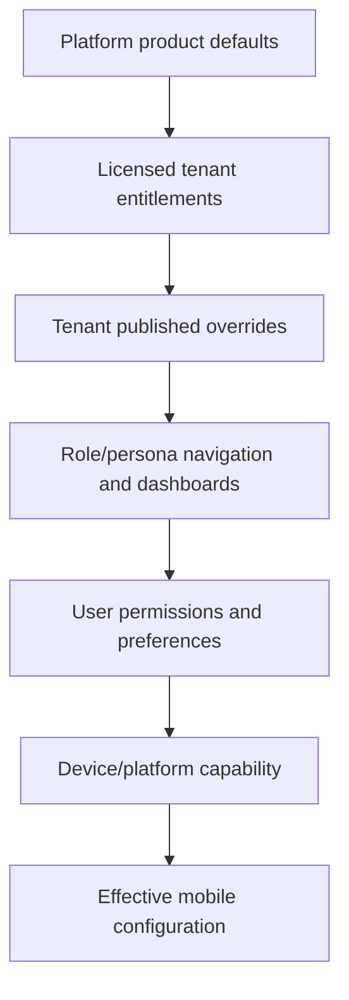

# HR Management Mobile — Admin Configuration Plan

## 1. Purpose

This document defines how the .NET MAUI application and its mobile backend are configured from the HR Management Admin ecosystem. It covers Admin pages, permissions, configuration hierarchy, SQL entities, Admin DTOs, services, validation, draft/publish/versioning, release controls, security floors, notification templates, and the published configuration consumed by the app.

This is an **implementation plan**. The mobile configuration pages described here do not yet exist.

## 2. Existing Admin Capability Versus Required Work

| Capability | Current state | Mobile use |
|---|---|---|
| Clients and tenants `/admin/tenants` | Implemented in SQL | Select tenant and verify it is active/licensed |
| Career-site configuration `/admin/career-site` | Implemented | Separate product surface; do not reuse its page configuration as mobile configuration |
| HR masters `/admin/masters` | Implemented | Supplies controlled values used by mobile forms and filters |
| Job openings `/admin/jobs` | Implemented | Existing job data can later be exposed through mobile APIs |
| Media library `/admin/media` | Implemented | Reuse for approved tenant mobile logos/images; add private/public classification |
| Accounts `/admin/accounts` | Implemented | Provisions HR and Employee identities and roles |
| Roles and permissions `/admin/roles` | Implemented | Drives mobile menu/action visibility and API authorisation |
| Mobile configuration `/admin/mobile/*` | **Not implemented** | Must be built from this document |
| Mobile OIDC client/device sessions | **Not implemented** | Must be added to Identity and Admin security pages |
| Module entitlements/release policy | **Not implemented** | Must be added before production mobile release |
| Push provider and notification templates | **Not implemented** | Must be added with secrets stored outside SQL configuration JSON |
| Mobile config audit/version rollback | **Not implemented** | Must be added with publish workflow |

The first implementation uses the existing Platform Admin portal and its SQL-backed login. It must not make the bootstrap password or current development credential part of mobile configuration.

## 3. Administration Levels

### 3.1 Vertex Platform Admin

Current route area: `/admin/*`, protected by `AccountPortal.Platform` and the existing Admin policy.

Platform Admin may:

- define product-wide mobile templates and approved route/widget catalogues;
- enable licensed modules for a tenant;
- establish non-bypassable security and offline floors;
- configure app-store versions and maintenance policy;
- manage OIDC client metadata references and push-provider references;
- create, review, publish, roll back, and audit tenant mobile configuration;
- preview configuration as HR, Recruiter, Manager, or Employee.

### 3.2 Tenant HR Configuration Admin

Future route area: `/hr/settings/mobile/*`, protected by HR bearer/cookie identity and mobile-configuration permissions.

Tenant configuration administrators may be delegated safe options:

- tenant logo and approved brand colours;
- enabled navigation among already licensed modules;
- home-widget ordering and role-specific quick actions;
- tenant contact/support/legal links;
- notification wording within locked templates;
- feature rollout percentages or groups where the license permits it.

They may not edit:

- OAuth signing keys, client secrets, issuer/audience, SQL connection strings, storage paths, or push credentials;
- platform minimum app version/security floor;
- another tenant's configuration;
- arbitrary API URLs, Shell routes, SQL queries, report definitions, or permission keys;
- controls that would expose salary, candidate PII, documents, or administrative actions without API permission.

Initially, tenant delegation may be postponed and all configuration may remain in `/admin`. The data/service design must still retain tenant scope so delegation can be added without rewriting it.

## 4. Configuration Resolution Hierarchy



Precedence and restrictions:

1. Platform security floors and route/widget catalogues are immutable to tenants.
2. License entitlements can disable a module; tenant configuration cannot re-enable it.
3. A tenant published configuration may narrow availability or safely style the app.
4. Role/persona layout selects the navigation/dashboard candidate set.
5. Effective user permissions remove inaccessible items and actions.
6. Device capability removes unsupported native actions.
7. User preferences may reorder only items explicitly marked user-customisable.

The server computes the final response. The MAUI client must not merge raw security or license rules itself.

## 5. Admin Page Inventory — 15 Pages

| ID | Admin page | Route | Purpose | Required access |
|---|---|---|---|---|
| MADM-001 | Mobile Overview | `/admin/mobile` | Tenant readiness, published version, modules, app versions, alerts | Platform Admin |
| MADM-002 | App Identity | `/admin/mobile/app` | App display name, tenant label, locale/time zone/currency and public metadata | Platform Admin; future `MOBILE.CONFIG.MANAGE` |
| MADM-003 | Branding and Assets | `/admin/mobile/branding` | Logos, splash, semantic colours, typography and theme mode | Platform Admin; delegated branding permission |
| MADM-004 | Modules and Entitlements | `/admin/mobile/modules` | License-controlled module enablement and availability messaging | Platform Admin only for license; tenant may narrow |
| MADM-005 | Navigation Designer | `/admin/mobile/navigation` | Persona-specific tabs, flyout groups, labels, icons, order and routes | Platform Admin; future tenant manage |
| MADM-006 | Dashboard Layouts | `/admin/mobile/dashboards` | HR/Employee/Manager/Recruiter widget order, size and visibility | Platform Admin; future tenant manage |
| MADM-007 | Quick Actions | `/admin/mobile/quick-actions` | Persona action catalogue, order, pinning and online requirements | Platform Admin; future tenant manage |
| MADM-008 | Security and Session Policy | `/admin/mobile/security` | PIN, biometric, device trust, session, screenshot and offline security | Platform security authority only |
| MADM-009 | Offline and Cache Policy | `/admin/mobile/offline` | Approved read areas, TTLs, storage limit, outbox actions and revocation | Platform security authority; tenant can narrow |
| MADM-010 | Notifications | `/admin/mobile/notifications` | Push events, mandatory notices, templates, quiet-hour defaults and deep-link actions | Platform Admin; future notification permission |
| MADM-011 | Deep Links and Universal Links | `/admin/mobile/deep-links` | Whitelisted link patterns mapped to registered screen routes | Platform Admin only |
| MADM-012 | Releases and Store Policy | `/admin/mobile/releases` | Minimum/recommended versions, staged rollout, store URLs and release notes | Platform release permission |
| MADM-013 | Maintenance and Availability | `/admin/mobile/maintenance` | Planned outage window, read-only mode and tenant availability message | Platform operations permission |
| MADM-014 | Integrations | `/admin/mobile/integrations` | OIDC client metadata, push-provider reference, support/crash/analytics consent settings | Platform security/integration permission |
| MADM-015 | Versions, Audit and Rollback | `/admin/mobile/versions` | Draft diff, validation, publish history, actor audit and rollback | View/publish/audit permissions |

Every page includes the existing tenant selector. A banner must clearly show whether the editor is changing **Platform defaults**, a **tenant draft**, or viewing a **published version**.

## 6. Existing Admin Pages Reused Instead of Duplicated

| Existing page | Mobile configuration relationship |
|---|---|
| `/admin/tenants` | Tenant activation, primary domain and future mobile entitlement summary |
| `/admin/accounts` | HR/Employee account provisioning, account disablement and role assignment |
| `/admin/roles` | Permission grants used by API policies and mobile navigation filtering |
| `/admin/masters` | Controlled option codes consumed through `/api/mobile/v1/masters` |
| `/admin/media` | Upload/select logos, splash images and approved dashboard imagery |
| `/admin/jobs` | Source job records; not a mobile screen-layout editor |
| `/admin/career-site` | Separate public careers website theme/content; mobile branding may copy values once but has its own published version |

Do not add a second mobile accounts page, second masters page, or second media library.

## 7. Draft, Preview, Publish and Rollback Workflow

```text
Published v12
   |
   +--> Create/edit Draft based on v12
          |
          +--> Validate schema, assets, routes, permissions and security floors
          |
          +--> Preview as persona + platform + theme mode
          |
          +--> Publish v13 atomically
                    |
                    +--> Invalidate configuration cache
                    +--> notify devices that v13 exists
                    +--> retain immutable v12 snapshot
```

Rules:

- Autosave writes draft only and never changes mobile clients.
- Publish requires a fresh row version and validation result.
- Publishing stores an immutable snapshot, actor, timestamp, reason, source version and checksum.
- Rollback creates a new version from an older snapshot; it never deletes history.
- Security reductions and module/license changes may require a second approver.
- The published mobile endpoint returns a monotonically increasing configuration version plus `ETag`.
- Devices receive configuration invalidation by next heartbeat/push, but always validate API permissions independently.

## 8. SQL Persistence Design

Use the existing `platform` schema because mobile configuration is a tenant/platform concern.

### 8.1 Primary aggregate

`platform.MobileAppConfigurations`

| Column | Type/purpose |
|---|---|
| `Id` | `bigint` primary key |
| `TenantKey` | unique tenant key, foreign-key/logical reference to tenant |
| `DraftJson` | current validated/unvalidated editor draft |
| `DraftBasedOnVersion` | published version from which draft originated |
| `PublishedJson` | current published aggregate for fast reads |
| `PublishedVersion` | monotonically increasing `bigint` |
| `PublishedChecksum` | SHA-256 checksum of canonical published JSON |
| `DraftUpdatedUtc/ByUserId` | draft audit metadata |
| `PublishedUtc/ByUserId` | publish audit metadata |
| `RowVersion` | SQL row version for concurrency |

The aggregate JSON is suitable because clients fetch one coherent configuration and publish must be atomic. It contains only non-secret product configuration.

### 8.2 Version and audit tables

`platform.MobileConfigurationVersions`

- tenant key, version, canonical snapshot JSON, checksum;
- source version and action (`Publish`, `Rollback`, `Import`);
- actor, reason and UTC timestamp;
- validation result summary;
- immutable after creation.

`platform.MobileConfigurationAudit`

- tenant, actor, action, section, target version;
- safe diff summary, correlation ID, UTC timestamp and originating IP/session reference;
- no secrets, signing keys, tokens or full private templates.

### 8.3 Release and operational policy

`platform.MobileReleasePolicies`

- platform (`Android`, `iOS`), channel (`Production`, `Pilot`, `Internal`);
- minimum, recommended and latest version;
- force-update flag/date, rollout percentage/group, store URL;
- release notes reference, maintenance compatibility, row version.

`platform.MobileMaintenanceWindows`

- tenant/global scope, start/end UTC, mode (`Blocked`, `ReadOnly`, `Degraded`);
- title/message, support URL, affected module codes, active flag and row version.

### 8.4 Integration references

`platform.MobileIntegrationReferences`

- tenant/global scope and integration type;
- non-secret provider name, secret-store key/reference, enabled state and environment;
- health state, last verified date and row version.

Actual OIDC signing keys, push credentials, client secrets, connection strings, and vendor tokens remain in environment configuration or a secret vault. SQL stores references and safe metadata only.

### 8.5 Existing tables reused

- `platform.Tenants`
- `platform.MasterOptions`
- `platform.MediaAssets` after adding asset visibility/classification if needed
- `identity.Users`, `identity.Roles`, `identity.RolePermissions`, `identity.IdentityAudit`

## 9. Configuration Aggregate

```csharp
public sealed class MobileAppConfigurationDto
{
    public string TenantKey { get; set; } = string.Empty;
    public long Version { get; set; }
    public MobileAppIdentityDto App { get; set; } = new();
    public MobileBrandingDto Branding { get; set; } = new();
    public List<MobileModuleConfigurationDto> Modules { get; set; } = [];
    public List<MobilePersonaNavigationDto> Navigation { get; set; } = [];
    public List<MobileDashboardConfigurationDto> Dashboards { get; set; } = [];
    public List<MobileQuickActionConfigurationDto> QuickActions { get; set; } = [];
    public MobileSecurityConfigurationDto Security { get; set; } = new();
    public MobileOfflineConfigurationDto Offline { get; set; } = new();
    public MobileNotificationConfigurationDto Notifications { get; set; } = new();
    public List<MobileDeepLinkConfigurationDto> DeepLinks { get; set; } = [];
    public MobileSupportConfigurationDto Support { get; set; } = new();
}
```

This is the Admin edit/publish contract. `MobileConfigurationController` in `backend.md` returns a smaller **effective** client DTO after merging platform floors, license, tenant configuration, permissions and device capability.

## 10. Admin DTO Catalogue

DTOs live in `Vispl.HRManagement.Contracts.Admin.Mobile`, separate from mobile runtime DTOs.

### 10.1 Overview and lifecycle

| DTO | Key fields |
|---|---|
| `MobileAdminOverviewDto` | tenant readiness, draft/published versions, module count, release status, validation alerts |
| `MobileConfigurationEditorDto` | aggregate draft, based-on version, row version, validation state, last editor |
| `SaveMobileConfigurationDraftRequest` | tenant, section/full draft, row version, editor comment |
| `ValidateMobileConfigurationRequest` | tenant, target draft version, platform/persona combinations |
| `MobileConfigurationValidationDto` | valid flag, errors/warnings grouped by section and target path |
| `PublishMobileConfigurationRequest` | tenant, expected row version, publish reason, validation token, optional second approver |
| `PublishMobileConfigurationResultDto` | published version/checksum/date, invalidation status |
| `MobileConfigurationVersionDto` | version, action, actor, date, reason, checksum, source version |
| `MobileConfigurationDiffDto` | from/to versions and safe section/path changes |
| `RollbackMobileConfigurationRequest` | tenant, source version, reason, expected current version |

### 10.2 App identity and branding

| DTO | Key fields |
|---|---|
| `MobileAppIdentityDto` | display name, short name, tenant label, default locale/time zone/currency, support/legal references |
| `MobileBrandingDto` | light/dark logo media IDs, splash media ID, semantic colours, typography, radius, density, theme-mode policy |
| `MobileColorTokensDto` | primary/accent/surface/background/text/status tokens with contrast results |
| `MobileTypographyDto` | approved font family keys, scale and weight tokens |
| `MobileAssetSelectionDto` | media ID, purpose, alt text, crop/focal point, background treatment |
| `MobileThemePreviewRequest` | tenant draft/version, persona, platform, device size, light/dark mode |
| `MobileThemePreviewDto` | resolved tokens/assets, warnings and preview payload/reference |

Branding validation:

- colours must parse and meet minimum contrast for their semantic pairs;
- status/security colours cannot be tenant-overridden;
- media must belong to the selected tenant or be an approved platform asset;
- logos must meet dimension, aspect-ratio, transparency and size constraints;
- only packaged/approved font keys are allowed; arbitrary remote font URLs are rejected.

## 11. Module and Entitlement Configuration

### 11.1 Approved modules

| Module code | Area | Default personas | Backend dependency |
|---|---|---|---|
| `HOME` | Role home and quick actions | All | Home/config APIs |
| `RECRUITMENT` | Requisitions/jobs/applications/interviews/offers | HR, Recruiter, Interviewer | Recruitment services/controllers |
| `EMPLOYEES` | Directory and employee lifecycle | HR, Manager; self subset | Employee services/controllers |
| `ONBOARDING` | Employee onboarding/checklists | HR, Manager, Employee | Onboarding services/controller |
| `ATTENDANCE` | Punch, attendance, corrections | Employee, Manager, HR | Attendance services/controller |
| `SHIFTS` | Rosters and assignments | Employee, Manager, HR | Shift services/controller |
| `LEAVE` | Balance/request/calendar/approval | Employee, Manager, HR | Leave services/controllers |
| `PAYROLL` | Payslip/tax/salary | Employee, Payroll HR | Payroll services/controller |
| `REIMBURSEMENTS` | Expense claims | Employee, Approver, Payroll | Reimbursement services/controller |
| `BENEFITS` | Benefit coverage/enrolment | Employee, Benefits HR | Benefits services/controller |
| `APPROVALS` | Unified approval inbox/delegation | Approvers | Approval services/controller |
| `HR_REQUESTS` | Service catalog and dynamic requests | All eligible | Request services/controller |
| `REPORTS` | Mobile-safe reports/exports | Permission holders | Reports/exports controllers |
| `OFFLINE` | Approved cached reads/outbox | Licensed/approved users | Sync/security services |

### 11.2 DTOs

| DTO | Key fields |
|---|---|
| `MobileModuleConfigurationDto` | module code, licensed, tenant enabled, start/end dates, audience, unavailable message |
| `MobileEntitlementDto` | tenant, module, plan, limits, validity and source |
| `SaveMobileModuleConfigurationRequest` | tenant, module states and row version |
| `MobileModuleReadinessDto` | API, data, permission, master, workflow, integration and configuration readiness checks |

Module states are computed:

```text
EffectiveEnabled = PlatformAvailable
                   AND Licensed
                   AND TenantEnabled
                   AND WithinEffectiveDates
                   AND BackendReady
                   AND UserHasAtLeastOneModulePermission
```

Admin cannot mark a module ready when its controller/application/persistence dependencies are missing. The Overview page must show readiness failures instead of exposing a dead menu item.

## 12. Navigation Designer

Navigation is selected from the registered route catalogue in `screens.md`; administrators cannot type arbitrary routes.

### 12.1 Navigation DTOs

| DTO | Key fields |
|---|---|
| `MobileRouteDefinitionDto` | route key, Shell route, screen ID, module, default label/icon, permission, platform support |
| `MobilePersonaNavigationDto` | persona code, home route key, bottom tabs, flyout groups, maximum tab count |
| `MobileNavigationGroupAdminDto` | key, label, icon, order, items, collapsible flag |
| `MobileNavigationItemAdminDto` | key, label override, approved route key, icon key, order, badge source, permission/module |
| `SaveMobileNavigationRequest` | tenant, persona navigation list, row version |

### 12.2 Personas

```text
HR_ADMIN
HR_EXECUTIVE
RECRUITER
INTERVIEWER
REPORTING_MANAGER
EMPLOYEE
CUSTOM_ROLE_FALLBACK
```

Custom roles resolve to a base persona plus their actual permission set. A custom role never injects arbitrary routes.

### 12.3 Validation

- Home route must be enabled and permitted for the persona.
- Phone bottom navigation has 3–5 primary items; overflow belongs in More/Flyout.
- Route, module and permission must agree.
- Duplicate route keys in the same surface are rejected.
- Labels have localisation keys and length limits.
- Icon keys come from the packaged icon catalogue.
- Employee persona cannot receive Platform Admin routes.
- Hidden navigation never replaces API authorisation.

## 13. Dashboard and Quick-Action Configuration

The admin selects from a registered widget/action catalogue. It cannot define a SQL query, URL, assembly type, or arbitrary JSON renderer.

### 13.1 Approved dashboard widget keys

| Persona | Examples |
|---|---|
| HR/Recruiter | `jobs.total`, `jobs.active`, `applicants.total`, `interviews.upcoming`, `pipeline.funnel`, `approvals.pending`, `onboarding.overdue` |
| Manager | `team.present`, `team.onLeave`, `approvals.pending`, `probation.due`, `interviews.assigned`, `team.birthdays` |
| Employee | `attendance.today`, `leave.balances`, `tasks.pending`, `payslip.latest`, `announcements`, `requests.recent` |

Each key maps to a server-owned projection and one of the safe visual widgets in `widgets.md`, such as `KpiTile`, `MetricTrendCard`, `ChartCard`, `InterviewCard`, or `LeaveBalanceCard`.

### 13.2 DTOs

| DTO | Key fields |
|---|---|
| `MobileWidgetDefinitionDto` | widget key, display name, supported personas/sizes, required module/permission, data-source key |
| `MobileDashboardConfigurationDto` | persona, columns/breakpoints and ordered widget instances |
| `MobileDashboardWidgetAdminDto` | instance ID, widget key, title override, size/order, visibility, refresh class, target route |
| `MobileQuickActionDefinitionDto` | action key, route, icon, module, permission, online/destructive flags |
| `MobileQuickActionConfigurationDto` | persona, ordered actions, pinning policy and maximum count |
| `SaveMobileDashboardRequest` | tenant, persona configurations, row version |
| `SaveMobileQuickActionsRequest` | tenant, persona configurations, row version |

## 14. Security and Session Configuration

Security is the intersection of a platform floor and an optional stricter tenant policy.

| Setting | Platform-controlled rule |
|---|---|
| Access-token lifetime | Short fixed range; not freely tenant-editable |
| Refresh-token rotation | Always on with reuse detection |
| Device registration | Required for production; tenant can require approval/stronger trust |
| App PIN | Platform may require; tenant may require sooner, not disable floor |
| Biometric | Optional convenience around local secure key; never sole server authentication |
| Idle/session lifetime | Tenant may shorten within allowed range |
| Offline grant | Disabled by default; explicit role/module/TTL limits |
| Screenshot protection | Required on configured sensitive screens where platform supports it |
| Clipboard/copy | Denied by default for salary, tax, identifiers and protected documents |
| Root/jailbreak/device integrity | Policy response is configurable; security bypass is not |
| Concurrent devices | Platform range; revocation visible in device Admin |
| Reauthentication | Required before protected reveal, device changes and selected approvals |

DTOs:

| DTO | Key fields |
|---|---|
| `MobileSecurityConfigurationDto` | PIN/biometric/device/session/re-auth/screenshot/copy/integrity policy |
| `MobileSecurityFloorDto` | immutable minimum/maximum values and required controls |
| `SaveMobileSecurityRequest` | tenant stricter values, expected row version and reason |
| `MobileSecurityValidationDto` | effective policy, rejected weakenings and device/platform warnings |
| `MobileDeviceAdminDto` | tenant/user/device/trust/current version/last seen/revocation state |
| `RevokeMobileDeviceRequest` | device ID, all tokens flag, reason |

Mobile device management may be shown under `/admin/accounts/{accountId}/devices` as a contextual view, avoiding a second account-management system.

## 15. Offline and Cache Configuration

### 15.1 Configurable fields

- global offline enabled/disabled;
- maximum encrypted cache size and retention;
- per-area read TTL and stale-display limit;
- approved roles/personas and device-trust level;
- approved outbox mutation codes;
- retry/backoff ceiling and maximum queued item count;
- whether attachment thumbnails or protected downloads may remain locally;
- wipe triggers: sign-out, revoke, role/tenant change, security stamp change, expiry.

### 15.2 Non-configurable prohibitions

The Admin cannot enable automatic offline caching for:

- unmasked candidate personal data or candidate documents;
- employee government identifiers;
- compensation structures, payroll runs, tax evidence, or benefits evidence;
- permission/role administration;
- approval decisions, offer sending, payroll closing, or destructive operations;
- access/refresh tokens outside platform secure storage.

### 15.3 DTOs

| DTO | Key fields |
|---|---|
| `MobileOfflineConfigurationDto` | enabled, max bytes, wipe policy, entity read rules, action rules |
| `MobileOfflineEntityRuleDto` | entity set, allowed, TTL, stale limit, field projection key |
| `MobileOfflineActionRuleDto` | action code, allowed, max age/retries, conflict strategy, device requirement |
| `SaveMobileOfflineConfigurationRequest` | tenant policy and row version |

## 16. Notification Configuration

### 16.1 Event catalogue

Initial event groups:

```text
SECURITY:         new device, password/security change, session revoked
RECRUITMENT:      interview assigned/changed, evaluation due, offer approval
EMPLOYEE:         onboarding task, document expiry, probation due
ATTENDANCE:       missing punch, correction update, overtime decision
LEAVE:            request submitted/decided, approval due, balance adjustment
PAYROLL:          payslip available, declaration deadline, reimbursement update
APPROVALS:        approval assigned/escalated/delegated
REQUESTS:         request status/SLA/comment
SYSTEM:           maintenance, required update, policy/legal notice
```

Security, required update, and critical system notices cannot be disabled by tenant/user preferences.

### 16.2 DTOs

| DTO | Key fields |
|---|---|
| `MobileNotificationConfigurationDto` | enabled channels, event definitions, default quiet hours, retention, provider reference |
| `MobileNotificationEventDefinitionDto` | event key/group, audience, mandatory flag, channels, template keys, deep-link key |
| `MobileNotificationTemplateDto` | locale, title/body templates, allowed tokens, fallback and locked regions |
| `MobilePushProviderReferenceDto` | provider/environment, secret reference, bundle/app IDs, verified state |
| `SaveMobileNotificationConfigurationRequest` | tenant event/template overrides and row version |
| `TestMobileNotificationRequest` | tenant, event key, locale, test recipient/device, sample safe tokens |
| `TestMobileNotificationResultDto` | accepted/provider reference and delivery state |

Template tokens are allow-listed per event. Templates cannot access arbitrary employee/candidate fields. Push payloads contain minimal non-sensitive text and an opaque deep-link/resource reference; the app fetches authorised detail after opening.

## 17. Deep-Link Configuration

Deep links map approved public patterns to registered route keys.

Examples:

```text
https://app.hr.example.com/mobile/notifications/{id} -> notification.detail
https://app.hr.example.com/mobile/approvals/{id}     -> approval.detail
https://app.hr.example.com/mobile/interviews/{id}    -> interview.detail
visplhr://requests/{id}                              -> request.detail
```

DTOs:

| DTO | Key fields |
|---|---|
| `MobileDeepLinkConfigurationDto` | link key, approved URI pattern, route key, parameter mapping, module/permission, active flag |
| `MobileDeepLinkDomainDto` | host, Android asset-link state, iOS association state, last verified date |
| `SaveMobileDeepLinksRequest` | tenant links and row version |
| `VerifyMobileDeepLinksResultDto` | host/platform checks, errors and resolved sample routes |

Validation rejects open redirects, arbitrary schemes/hosts, unknown route parameters, cross-tenant resource hints, and any route lacking a permission gate.

## 18. Release, Maintenance and Integration Configuration

### 18.1 Release DTOs

| DTO | Key fields |
|---|---|
| `MobileReleasePolicyAdminDto` | platform/channel, minimum/recommended/latest version, enforcement date, rollout and store link |
| `SaveMobileReleasePolicyRequest` | policy plus row version and reason |
| `MobileReleaseNoteDto` | version, locale, title, safe rich content, publish date |
| `MobileRolloutGroupDto` | group key, tenant/user cohort definition reference, percentage, start/end |

Version comparison uses semantic version fields, not string ordering. A force update requires valid store URLs and a tested minimum backend contract.

### 18.2 Maintenance DTOs

| DTO | Key fields |
|---|---|
| `MobileMaintenanceWindowDto` | scope, times, mode, affected modules, title/message, support link, row version |
| `SaveMobileMaintenanceWindowRequest` | schedule, impact and reason |
| `MobileAvailabilityPreviewDto` | effective state for tenant/platform/version at a supplied UTC time |

### 18.3 Integration DTOs

| DTO | Key fields |
|---|---|
| `MobileIdentityProviderReferenceDto` | authority, public client ID, redirect URI set, metadata health; no secrets |
| `MobileIntegrationReferenceDto` | type/provider/environment, secret reference, enabled/health state |
| `VerifyMobileIntegrationRequest` | integration ID and safe test mode |
| `MobileIntegrationHealthDto` | verified date, status, safe error code/message |

## 19. Admin Management Controllers

These are **Admin APIs**, not endpoints consumed by the MAUI app. The existing Blazor Server Admin pages may initially call BM interfaces directly, as current pages do. Add these controllers when a remote Admin frontend or automation requires them.

| Controller | Route | Operations |
|---|---|---|
| `AdminMobileConfigurationController` | `/api/admin/v1/mobile/configurations` | overview, get draft/published, save section/full draft, validate, publish, rollback |
| `AdminMobileCatalogController` | `/api/admin/v1/mobile/catalog` | routes, widgets, quick actions, modules, icons, security floors |
| `AdminMobileReleaseController` | `/api/admin/v1/mobile/releases` | release policy, release notes and rollout groups |
| `AdminMobileMaintenanceController` | `/api/admin/v1/mobile/maintenance` | maintenance CRUD and availability preview |
| `AdminMobileIntegrationController` | `/api/admin/v1/mobile/integrations` | safe references, verification and health |
| `AdminMobileDeviceController` | `/api/admin/v1/mobile/devices` | tenant/account device search and revocation |
| `AdminMobileNotificationController` | `/api/admin/v1/mobile/notifications` | event/template configuration and test delivery |
| `AdminMobileAuditController` | `/api/admin/v1/mobile/audit` | version list, diff, audit search and export |

Admin APIs use the Platform Admin cookie for same-origin web UI or an explicitly separate Admin API access token for external automation. They never accept a mobile HR/Employee access token as Platform Admin authority.

## 20. Business and Repository Interfaces

```text
BM.ITF/Admin/Mobile
├── IMobileConfigurationService
├── IMobileConfigurationPublisher
├── IMobileConfigurationValidator
├── IMobileCatalogService
├── IMobileReleasePolicyService
├── IMobileMaintenanceService
├── IMobileNotificationConfigurationService
├── IMobileIntegrationReferenceService
└── IMobileConfigurationAuditService

DL.ITF/Admin/Mobile
├── IMobileConfigurationRepository
├── IMobileConfigurationVersionRepository
├── IMobileReleasePolicyRepository
├── IMobileMaintenanceRepository
├── IMobileIntegrationReferenceRepository
└── IMobileConfigurationAuditRepository
```

The runtime service in `backend.md` depends on a read-only contract such as `IPublishedMobileConfigurationProvider`. It cannot read Admin drafts.

## 21. Permission Additions

The current permission catalogue covers accounts, roles, recruitment, employees, attendance, leave, payroll, reports and employee self-service at a broad level. Add mobile configuration permissions for future tenant delegation:

| Permission key | Portal | Purpose |
|---|---|---|
| `MOBILE.CONFIG.VIEW` | HR | View published/draft tenant mobile configuration |
| `MOBILE.CONFIG.MANAGE` | HR | Edit safe app identity, navigation, dashboard and quick-action settings |
| `MOBILE.BRANDING.MANAGE` | HR | Select tenant media and safe theme tokens |
| `MOBILE.NOTIFICATIONS.MANAGE` | HR | Edit permitted event/template settings |
| `MOBILE.CONFIG.PUBLISH` | HR | Publish a validated tenant configuration |
| `MOBILE.CONFIG.AUDIT` | HR | View version history and safe diffs |

Keep these Platform-only regardless of tenant roles:

```text
MOBILE.PLATFORM.SECURITY
MOBILE.PLATFORM.ENTITLEMENTS
MOBILE.PLATFORM.RELEASES
MOBILE.PLATFORM.INTEGRATIONS
MOBILE.PLATFORM.ROLLBACK
```

For operational mobile screens, expand the existing broad permission catalogue before implementing controllers. At minimum define specific keys for requisitions, candidate PII/documents, interviews/evaluations, offers/compensation, onboarding, probation, offboarding, shifts, punches, corrections, payroll self/detail, tax, reimbursements, benefits, approvals, requests, protected files and device revocation. Do not use `RECRUITMENT.MANAGE` or `EMPLOYEES.EDIT` as an unlimited permission for every sensitive operation.

## 22. Published Runtime Configuration

The app calls:

```text
GET /api/mobile/v1/configuration
Authorization: Bearer <access token>
If-None-Match: "tenant-user-device-config-etag"
X-App-Version: 1.3.0
X-Platform: android
X-Device-ID: ...
```

The response contains only effective, safe client settings:

- tenant identity and media URLs;
- resolved theme tokens;
- enabled modules;
- permission-filtered navigation and dashboard widget instances;
- permitted quick actions;
- effective security/offline policy;
- notification preference definitions;
- deep-link route catalogue needed by the client;
- minimum/recommended version and maintenance state;
- support and legal links;
- configuration version and cache metadata.

It must never contain:

- tenant database keys not needed by the client;
- connection strings, signing/encryption keys, refresh tokens or push credentials;
- secret-store references;
- unpublished draft content;
- permissions the user does not possess as if they were enabled actions;
- arbitrary executable expressions, SQL, HTML script or remote assembly/plugin references.

## 23. Validation Before Publish

Publish is blocked unless all checks pass:

### Tenant and licensing

- tenant exists and is active;
- selected modules are licensed and backend-ready;
- effective dates and plan limits are valid.

### Routes and permissions

- every route/widget/action exists in the server catalogue;
- each item references an enabled module and valid permission;
- persona home routes and bottom navigation are valid;
- no Platform Admin route leaks to HR/Employee personas.

### Branding and media

- asset ownership/visibility is valid;
- size, type, aspect ratio and accessibility text pass;
- contrast and semantic colour checks pass.

### Security and offline

- tenant policy does not weaken platform floors;
- offline fields/actions use approved catalogues;
- protected/sensitive data is not cache-enabled;
- wipe and revocation behaviour is defined.

### Releases and links

- version rules compare correctly and store links are HTTPS/approved;
- universal/app link domains verify for both platforms;
- maintenance dates and messages are valid.

### Localisation

- default locale values exist;
- required legal/security/system templates have fallbacks;
- labels fit configured length and accessibility constraints.

## 24. Seed Configuration

Seed one conservative platform template and one tenant draft for development:

```text
Template:          Enterprise Standard
Theme:             Navy / white / gold semantic tokens
Personas:          HR Admin, Recruiter, Manager, Employee
Enabled modules:   Home, Recruitment, Employees, Onboarding, Leave, Notifications
Disabled initially Attendance punch, Payroll, Benefits, Offline outbox, Reports export
Security:          device registration on; rotating refresh tokens; protected screens no-store
Navigation:        registered routes only
Version policy:    no force update in Development
```

Seed configuration is imported through the same validator/publisher used by Admin. Do not insert an unchecked JSON blob directly into production.

## 25. Cache Invalidation and Device Update

On publish:

1. Commit aggregate and immutable version in one Admin transaction.
2. Add `MobileConfigurationPublished` to the outbox.
3. Invalidate server/distributed cache for the tenant.
4. Worker sends a data-only configuration-changed push where available.
5. Device heartbeat/configuration request detects the new version.
6. MAUI downloads, validates and atomically swaps configuration.
7. If navigation/security changed while a protected screen is open, the app finishes/cancels safely and re-evaluates access.

If the Worker or push provider is unavailable, normal configuration requests still converge; push is an optimisation, not the source of truth.

## 26. Testing Plan

### Admin tests

- draft save/concurrency and multi-user edit conflict;
- schema/security-floor/route/media/license validation;
- persona preview and permission filtering;
- publish, immutable snapshot, diff and rollback;
- tenant isolation and Platform-only controls;
- secret redaction and audit completeness.

### Runtime tests

- effective merge for platform, license, tenant, role, permission and device;
- `ETag`/304 and cache invalidation;
- disabled module and revoked permission disappear without granting API access;
- minimum version/maintenance behaviour;
- dark/light theme and accessibility-safe token resolution;
- previous published config remains available if a draft is invalid.

### End-to-end tests

```text
Admin edits draft
 -> validates
 -> previews Employee persona
 -> publishes v13
 -> mobile heartbeat observes v13
 -> mobile fetches v13 with correct role-filtered navigation
 -> old ETag receives new payload
 -> rollback publishes v14 based on v12
```

## 27. Implementation Order

1. Add Admin Mobile contracts, aggregate entity, repository, migration and conservative seed.
2. Add configuration catalogue for approved modules, screen routes, widget keys, quick actions, icons and permissions.
3. Implement configuration validator, draft/save, versioning, publish, rollback and audit.
4. Build Mobile Overview, App Identity, Branding, Modules and Navigation pages.
5. Add Dashboard and Quick Actions pages.
6. Add Security and Offline pages with immutable platform floors.
7. Add runtime `MobileConfigurationController` and MAUI bootstrap binding.
8. Add Notifications, Deep Links, Releases, Maintenance and Integration pages.
9. Add device/session Admin view and Worker invalidation event.
10. Add safe tenant delegation only after the HR portal and its authentication are implemented.

## 28. Definition of Done

Mobile Admin configuration is complete only when:

- configuration is SQL-backed and no tenant branding/navigation/module choice is hard-coded in MAUI;
- only published versions reach mobile clients;
- all edits are tenant-scoped, concurrent-safe and audited;
- platform security/license floors cannot be weakened;
- runtime payload contains no secrets or drafts;
- routes/widgets/actions are selected from registered catalogues;
- accounts, roles, masters, media and jobs reuse their existing pages/services;
- publish invalidates cache and devices converge even when push is unavailable;
- tenant-isolation, permission, rollback and configuration-schema tests pass;
- the MAUI app renders at least HR and Employee shells from the published configuration.

