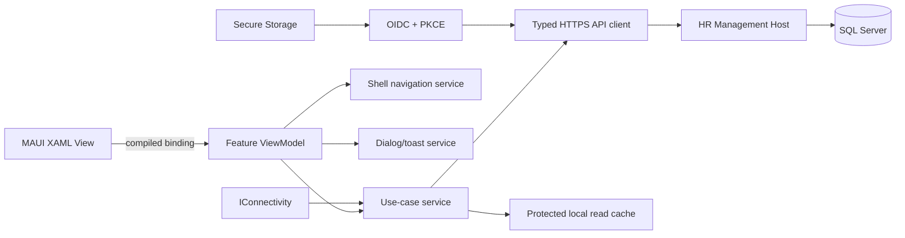

# HR Management Mobile — Screen and MVVM Plan

## 1. Purpose

This document is the implementation plan for the **Vispl HR Management mobile app** using **.NET MAUI**. It defines **112 routed screens**, their users, ViewModels, principal data bindings, commands, API boundaries, and offline behaviour.

The supplied mobile images are treated as visual references for compact cards, KPI tiles, tabbed lists, interview schedules, bottom navigation, and the profile flyout. They are not the complete product scope and should not be copied literally.

The source images are preserved and mapped to the planned screens and widgets in the [reference screen catalogue](docs/reference-screens.md).

## 2. Product Boundary

The first mobile application serves authenticated internal users:

- HR administrators and HR executives
- Recruiters and interviewers
- Reporting managers and approvers
- Employees using self-service features
- Custom roles created through the existing role and permission system

The public candidate experience is a separate future application/security surface. Candidate records may be viewed by authorised HR users inside this app, but external candidates do not sign in to the employee/HR app.

The mobile app is an **API client only**. It must not reference the server BM, DL, repositories, `DbContext`, or SQL Server. It may reference stable request/response contracts and call HTTPS APIs exposed by `Vispl.HRManagement.Host`.

## 3. Current Implementation State

`Vispl.HRManagement.Mobile` is now a runnable .NET MAUI single-project application. The first implemented design slice contains the responsive login, role-aware Shell, dashboard, jobs and job detail, applicants and applicant detail, interview schedule, notifications, reusable card/header/status widgets, compiled bindings, dependency injection, Android platform setup and Windows developer runtime.

The current screens use `PreviewAuthenticationService` and `DemoDataService` behind interfaces. This is intentional UI scaffolding, not production authentication or data access. Before deployment, replace those adapters with OIDC Authorization Code + PKCE, secure token storage and typed HTTPS clients for the implemented mobile APIs. iOS/Mac Catalyst project files are present but require a macOS build/signing environment for validation.

Suggested solution boundary:

```text
Vispl.HRManagement.Mobile                 MAUI executable, XAML views and composition root
Vispl.HRManagement.Mobile.Core            ViewModels, navigation, validation, local abstractions
Vispl.HRManagement.Mobile.Infrastructure  REST clients, auth, secure storage, cache and sync
Vispl.HRManagement.Contracts              Stable API request/response DTOs shared with Host
```

`Mobile.Core` and `Mobile.Infrastructure` can initially remain folders in the main project. Extract them into projects only when build time, ownership, or testing justifies it.

## 4. Application Architecture



Recommended feature-first folder structure:

```text
Vispl.HRManagement.Mobile
├── App.xaml
├── MauiProgram.cs
├── Shell
│   ├── AppShell.xaml
│   ├── HrShell.xaml
│   ├── ManagerShell.xaml
│   └── EmployeeShell.xaml
├── Features
│   ├── Authentication
│   ├── Home
│   ├── Recruitment
│   ├── Employees
│   ├── Attendance
│   ├── Leave
│   ├── Payroll
│   ├── Approvals
│   ├── Reports
│   └── Settings
├── Shared
│   ├── Controls
│   ├── Converters
│   ├── Navigation
│   ├── Security
│   ├── Services
│   ├── State
│   ├── Styles
│   └── Validation
└── Platforms
```

Each feature owns its `Pages`, `ViewModels`, models used only for presentation, and feature service interfaces. A feature must not navigate by creating another feature's page or call another feature's repository directly. Cross-feature operations go through navigation routes and application/API contracts.

## 5. MVVM and Data-Binding Standard

Use `CommunityToolkit.Mvvm` source generators:

- `ObservableObject` and `[ObservableProperty]` for state
- `[RelayCommand]` and `[RelayCommand(AllowConcurrentExecutions = false)]` for actions
- `ObservableValidator` for input validation
- Constructor injection for all services
- Page code-behind limited to `InitializeComponent` and unavoidable native lifecycle forwarding

Every XAML page and `DataTemplate` must declare `x:DataType`. Use compiled bindings and enable warnings as errors for binding compilation after migration. Never set a `BindingContext` through a service locator.

```xml
<ContentPage
    x:Class="Vispl.HRManagement.Mobile.Features.Leave.Pages.LeaveBalancesPage"
    xmlns:vm="clr-namespace:Vispl.HRManagement.Mobile.Features.Leave.ViewModels"
    x:DataType="vm:LeaveBalancesViewModel">

    <RefreshView
        Command="{Binding RefreshCommand}"
        IsRefreshing="{Binding IsRefreshing}">
        <CollectionView ItemsSource="{Binding Balances}">
            <CollectionView.ItemTemplate>
                <DataTemplate x:DataType="models:LeaveBalanceItem">
                    <widgets:LeaveBalanceCard Item="{Binding .}" />
                </DataTemplate>
            </CollectionView.ItemTemplate>
        </CollectionView>
    </RefreshView>
</ContentPage>
```

All screen ViewModels inherit a small common base:

```csharp
public abstract partial class ScreenViewModel : ObservableValidator
{
    [ObservableProperty] private bool isBusy;
    [ObservableProperty] private bool isRefreshing;
    [ObservableProperty] private bool isOffline;
    [ObservableProperty] private string? errorMessage;

    public bool HasError => !string.IsNullOrWhiteSpace(ErrorMessage);
    public abstract Task LoadAsync(CancellationToken cancellationToken);
}
```

Rules:

1. Views bind to ViewModels; widgets bind to values and commands. Widgets never call APIs.
2. Async commands expose busy state, disable duplicate submission, accept cancellation, and translate typed API failures into user-safe messages.
3. List screens use `ObservableCollection<T>` or incremental sources. Collection mutations are dispatched on the UI thread.
4. Detail routes pass immutable scalar identifiers such as `employeeId`; the destination reloads authorised data. Do not pass full employee or candidate objects through navigation.
5. Route names are stable application contracts. Always await navigation and prevent double navigation.
6. Form ViewModels hold editable draft state separate from server DTOs. Mapping occurs at the use-case boundary.
7. Permission visibility is computed from claims/permissions and must also be enforced by the API. Hidden UI is not security.

## 6. Authentication, Tenant and Session Plan

- Use browser-based OpenID Connect/OAuth 2.0 Authorization Code flow with PKCE.
- Do not embed a client secret or collect the enterprise identity provider password inside the app.
- Store only small secrets such as refresh tokens/device keys in `SecureStorage`; keep ordinary preferences elsewhere.
- Access tokens stay in memory and are attached by an authorised HTTP handler.
- Rotate refresh tokens and revoke the device session on logout, password reset, account disablement, or administrator action.
- Tenant/company selection happens before authentication when the installation is not preconfigured.
- The API returns the effective tenant, user, role set, permission claims, enabled modules, and visual theme after sign-in.
- A role-aware shell is rebuilt after claims change. The app must not rely on a stale menu for authorisation.

## 7. API, Cache and Synchronisation Rules

Planned typed clients:

```text
ISessionApiClient       IHomeApiClient          IRecruitmentApiClient
IEmployeeApiClient      IAttendanceApiClient    ILeaveApiClient
IPayrollApiClient       IApprovalApiClient      IReportApiClient
INotificationApiClient  IProfileApiClient       IMediaApiClient
```

All planned endpoints use `/api/mobile/v1/...` and return contracts such as `ApiEnvelope<T>`, `CursorPage<T>`, validation problems, correlation IDs, and server timestamps.

Caching policy:

| Class | Examples | Policy |
|---|---|---|
| Public configuration | colours, feature flags, non-sensitive labels | Disk cache with version/ETag |
| Low-risk user data | own leave balances, job summary, notification headers | Encrypted cache with short TTL |
| Sensitive HR data | compensation, government IDs, candidate documents | Memory only by default |
| Protected documents | payslips and offer documents | Explicit download, encrypted file, expiry and manual removal |
| Mutations | leave request, attendance correction, interview feedback | Online by default; narrowly approved outbox actions only |

When offline, screens show the last-sync timestamp and a visible offline banner. The app must never present cached data as current without disclosure. Every queued mutation has an idempotency key, local status, retry policy, and conflict handling. Destructive, approval, payroll, and permission changes are never silently queued.

## 8. Screen Inventory Summary

| Area | IDs | Count |
|---|---:|---:|
| Authentication and bootstrap | MOB-001–010 | 10 |
| Global shell and home | MOB-011–020 | 10 |
| Recruitment | MOB-021–048 | 28 |
| Employee lifecycle | MOB-049–068 | 20 |
| Attendance and shifts | MOB-069–078 | 10 |
| Leave | MOB-079–088 | 10 |
| Payroll and benefits | MOB-089–096 | 8 |
| Approvals and HR requests | MOB-097–102 | 6 |
| Reports, settings and support | MOB-103–112 | 10 |
| **Total** |  | **112** |

## 9. Detailed Screen Catalogue

Legend: **Live** = network required; **Read cache** = encrypted, time-limited local read; **Draft** = local user-entered draft; **No cache** = sensitive data remains in memory.

### 9.1 Authentication and Bootstrap — 10 screens

| ID | Screen and Shell route | Access | ViewModel | Principal bindings and commands | Planned API/cache |
|---|---|---|---|---|---|
| MOB-001 | App Bootstrap — `/app/start` | All | `AppBootstrapViewModel` | `Stage`, `Message`, `HasRecoverableError`; `Start`, `Retry` | Session/config/version checks; cached non-sensitive bootstrap |
| MOB-002 | Tenant Discovery — `/setup/company` | Signed out | `TenantDiscoveryViewModel` | `CompanyCode`, `Matches`, validation; `FindCompany`, `SelectTenant` | `GET /tenants/resolve`; cache selected tenant |
| MOB-003 | Welcome / SSO Sign In — `/auth/sign-in` | Signed out | `SignInViewModel` | `TenantBrand`, `Providers`, `IsSigningIn`; `SignIn`, `ChangeCompany` | OIDC discovery; no credential cache |
| MOB-004 | Completing Sign In — `/auth/callback` | Auth callback | `AuthCallbackViewModel` | `ProgressText`, `Failure`; `Complete`, `RestartSignIn` | Token exchange through PKCE; secure token storage |
| MOB-005 | Device Registration — `/auth/device` | Authenticated | `DeviceRegistrationViewModel` | `DeviceName`, `PushEnabled`, `TrustSummary`; `RegisterDevice` | `POST /session/devices`; device key in secure storage |
| MOB-006 | App PIN Setup — `/auth/pin/setup` | Authenticated | `PinSetupViewModel` | `Pin`, `ConfirmPin`, strength/errors; `SavePin`, `Skip` | Local protected verifier; never send PIN |
| MOB-007 | Biometric Opt-in — `/auth/biometric` | Authenticated | `BiometricSetupViewModel` | `Capability`, `IsEnabled`; `Enable`, `NotNow` | Native biometric gate around local session key |
| MOB-008 | Session Expired — `/auth/expired` | Expired session | `SessionExpiredViewModel` | `Reason`, `CanRetry`; `SignInAgain`, `ClearAndExit` | Refresh/re-auth; clear invalid secure tokens |
| MOB-009 | Offline Unlock — `/auth/offline` | Previously signed in | `OfflineUnlockViewModel` | `LastOnlineAt`, `AllowedUntil`, PIN/biometric state; `Unlock` | Local limited session; no server mutation |
| MOB-010 | Permission Primer — `/setup/permissions` | Authenticated | `PermissionPrimerViewModel` | Notification/camera/location states; `RequestPermission`, `Continue` | Native permissions; preferences only |

### 9.2 Global Shell and Home — 10 screens

| ID | Screen and Shell route | Access | ViewModel | Principal bindings and commands | Planned API/cache |
|---|---|---|---|---|---|
| MOB-011 | HR Dashboard — `/home/hr` | HR permissions | `HrDashboardViewModel` | KPI tiles, approvals, alerts, upcoming interviews; `Refresh`, `OpenMetric`, `QuickAction` | `GET /home/hr`; read cache |
| MOB-012 | Employee Home — `/home/employee` | Employee | `EmployeeHomeViewModel` | attendance state, leave balances, payslip, tasks; `Punch`, `RequestLeave`, `OpenTask` | `GET /home/employee`; limited read cache |
| MOB-013 | Manager Home — `/home/manager` | Manager | `ManagerHomeViewModel` | team presence, approvals, probation, interviews; `OpenTeam`, `OpenApproval` | `GET /home/manager`; read cache |
| MOB-014 | Global Search — `/search` | Signed in | `GlobalSearchViewModel` | `Query`, suggestions, recent queries, scope; `Search`, `ClearHistory` | `GET /search/suggestions`; local recent terms |
| MOB-015 | Search Results — `/search/results` | Permission filtered | `SearchResultsViewModel` | grouped results, filters, cursor state; `LoadMore`, `OpenResult`, `Refine` | `GET /search`; no sensitive result cache |
| MOB-016 | Notification Centre — `/notifications` | Signed in | `NotificationsViewModel` | tabs, unread count, items; `Refresh`, `MarkRead`, `MarkAllRead` | `GET/PATCH /notifications`; read cache |
| MOB-017 | Notification Detail — `/notifications/{notificationId}` | Recipient | `NotificationDetailViewModel` | title, body, actions, timestamp; `OpenAction`, `Delete` | `GET /notifications/{id}`; short read cache |
| MOB-018 | Unified Calendar — `/calendar` | Permission filtered | `UnifiedCalendarViewModel` | month/agenda, event types, selected date; `ChangeMonth`, `OpenEvent` | `GET /calendar`; read cache by date range |
| MOB-019 | Activity and Task Centre — `/activity` | Signed in | `ActivityCentreViewModel` | assigned tasks, due filters, progress; `CompleteTask`, `OpenTask` | `GET/PATCH /tasks`; read cache, safe idempotent updates |
| MOB-020 | Quick Actions — `/quick-actions` | Permission filtered | `QuickActionsViewModel` | permitted action groups and favourites; `Invoke`, `PinAction` | Claims/config plus local favourites |

### 9.3 Recruitment — 28 screens

| ID | Screen and Shell route | Access | ViewModel | Principal bindings and commands | Planned API/cache |
|---|---|---|---|---|---|
| MOB-021 | Recruitment Dashboard — `/recruitment` | Recruitment view | `RecruitmentDashboardViewModel` | job KPIs, pipeline funnel, interviews, ageing; `Refresh`, `OpenMetric` | `GET /recruitment/dashboard`; read cache |
| MOB-022 | Requisition List — `/recruitment/requisitions` | Requisition view | `RequisitionListViewModel` | status tabs, search, cursor items; `Filter`, `LoadMore`, `Open` | `GET /requisitions`; read cache |
| MOB-023 | Requisition Detail — `/recruitment/requisitions/{requisitionId}` | Requisition view | `RequisitionDetailViewModel` | role, headcount, budget, owner, status; `Edit`, `Submit`, `Cancel` | `GET/PATCH /requisitions/{id}`; live/read cache |
| MOB-024 | Create/Edit Requisition — `/recruitment/requisitions/edit` | Requisition manage | `RequisitionEditViewModel` | validated draft, department/location/job type; `SaveDraft`, `Next`, `Submit` | `POST/PUT /requisitions`; local draft |
| MOB-025 | Requisition Approval Trail — `/recruitment/requisitions/{requisitionId}/approvals` | Requisition/approval view | `RequisitionApprovalTrailViewModel` | approvers, decisions, timestamps, comments; `OpenApprover` | `GET /requisitions/{id}/approvals`; read cache |
| MOB-026 | Job Openings List — `/recruitment/jobs` | Job view | `JobListViewModel` | tabs, query, status chips, job cards; `Filter`, `Open`, `Create`, `LoadMore` | `GET /jobs`; read cache |
| MOB-027 | Job Filter and Sort — `/recruitment/jobs/filter` | Job view | `JobFilterViewModel` | departments, locations, status, dates, sort; `Apply`, `Reset` | Master data cache; navigation result |
| MOB-028 | Job Detail — `/recruitment/jobs/{jobId}` | Job view | `JobDetailViewModel` | summary, description, requirements, publication; `Edit`, `Duplicate`, `ChangeStatus` | `GET /jobs/{id}`; read cache |
| MOB-029 | Job Editor: Basics — `/recruitment/jobs/edit/basics` | Job manage | `JobBasicsViewModel` | title, requisition, masters, openings, dates; `SaveDraft`, `Next` | Draft API/local draft |
| MOB-030 | Job Editor: Description — `/recruitment/jobs/edit/content` | Job manage | `JobContentViewModel` | summary, responsibilities, requirements, skills; `SaveDraft`, `Back`, `Next` | Draft API/local draft |
| MOB-031 | Job Editor: Compensation — `/recruitment/jobs/edit/compensation` | Compensation manage | `JobCompensationViewModel` | min/max/currency/visibility/benefits; `SaveDraft`, `Back`, `Next` | Draft API; no local salary cache after submit |
| MOB-032 | Job Review and Publish — `/recruitment/jobs/edit/review` | Job publish | `JobPublishViewModel` | complete preview, validation, channels; `Publish`, `Schedule`, `ReturnToEdit` | `POST /jobs/{id}/publish`; live only |
| MOB-033 | Job Analytics — `/recruitment/jobs/{jobId}/analytics` | Recruitment analytics | `JobAnalyticsViewModel` | views, applications, conversion, sources, ageing; `ChangeRange`, `Export` | `GET /jobs/{id}/analytics`; read cache |
| MOB-034 | Applicant Pipeline — `/recruitment/jobs/{jobId}/pipeline` | Applicant view | `ApplicantPipelineViewModel` | stage columns/counts/cards; `MoveStage`, `OpenApplicant`, `Refresh` | `GET/PATCH /applications/pipeline`; optimistic with version check |
| MOB-035 | Applicant Search and Filter — `/recruitment/applicants` | Applicant view | `ApplicantSearchViewModel` | query, facets, saved filter, results; `Search`, `Filter`, `LoadMore` | `GET /applications`; memory only |
| MOB-036 | Application Summary — `/recruitment/applications/{applicationId}` | Applicant view | `ApplicationSummaryViewModel` | job/stage/rating/source/activity/actions; `ChangeStage`, `Rate`, `OpenCandidate` | `GET /applications/{id}`; memory only |
| MOB-037 | Candidate Profile (HR View) — `/recruitment/candidates/{candidateId}` | Candidate PII view | `CandidateProfileViewModel` | personal/professional/contact data with field permissions; `Call`, `Email`, `Edit` | `GET /candidates/{id}`; no cache |
| MOB-038 | Résumé Viewer — `/recruitment/candidates/{candidateId}/resume` | Candidate document view | `ResumeViewerViewModel` | secured document stream, pages, expiry; `DownloadProtected`, `ShareIfAllowed` | Short-lived signed stream; protected temp file |
| MOB-039 | Applicant Documents — `/recruitment/applications/{applicationId}/documents` | Candidate document view | `ApplicantDocumentsViewModel` | document list/status; `Preview`, `RequestDocument`, `Verify` | `GET/POST /applications/{id}/documents`; no list content cache |
| MOB-040 | Screening Scorecard — `/recruitment/applications/{applicationId}/screening` | Screening manage | `ScreeningScorecardViewModel` | criteria scores, notes, total, validation; `SaveDraft`, `Submit` | `GET/PUT /screenings/{id}`; encrypted draft, live submit |
| MOB-041 | Change Pipeline Stage — `/recruitment/applications/{applicationId}/stage` | Pipeline manage | `ChangeStageViewModel` | stages, reason, effective date; `ChangeStage`, `Cancel` | `POST /applications/{id}/stage`; live/idempotent |
| MOB-042 | Shortlist or Reject Decision — `/recruitment/applications/{applicationId}/decision` | Applicant decision | `ApplicantDecisionViewModel` | decision, reason, template, notify flag; `ConfirmDecision` | `POST /applications/{id}/decision`; live only |
| MOB-043 | Interview Schedule — `/recruitment/interviews` | Interview view | `InterviewScheduleViewModel` | date groups, filters, interview cards; `Open`, `Create`, `Refresh` | `GET /interviews`; read cache with PII minimised |
| MOB-044 | Create/Reschedule Interview — `/recruitment/interviews/edit` | Interview manage | `InterviewEditViewModel` | candidate/job/round/panel/slots/mode; `FindSlots`, `Schedule`, `Reschedule` | Availability + `POST/PUT /interviews`; live only |
| MOB-045 | Interview Detail — `/recruitment/interviews/{interviewId}` | Assigned/view permission | `InterviewDetailViewModel` | schedule, panel, candidate summary, join link; `Join`, `Reschedule`, `Evaluate` | `GET /interviews/{id}`; short read cache |
| MOB-046 | Interview Evaluation — `/recruitment/interviews/{interviewId}/evaluation` | Assigned interviewer | `InterviewEvaluationViewModel` | criteria, ratings, recommendation, notes; `SaveDraft`, `Submit` | `GET/PUT /evaluations/{id}`; encrypted draft |
| MOB-047 | Offer List — `/recruitment/offers` | Offer view | `OfferListViewModel` | status tabs, search, expiry, items; `Filter`, `Open`, `LoadMore` | `GET /offers`; memory only |
| MOB-048 | Offer Detail and Approval — `/recruitment/offers/{offerId}` | Offer view/approve | `OfferDetailViewModel` | package, approvals, document, version; `Approve`, `Reject`, `Generate`, `Send` | `GET/POST /offers/{id}/actions`; live, no compensation cache |

### 9.4 Employee Lifecycle — 20 screens

| ID | Screen and Shell route | Access | ViewModel | Principal bindings and commands | Planned API/cache |
|---|---|---|---|---|---|
| MOB-049 | Employee Directory — `/employees` | Directory view | `EmployeeDirectoryViewModel` | query, cursor employees, org grouping; `Search`, `Filter`, `Open`, `LoadMore` | `GET /employees`; minimal read cache |
| MOB-050 | Directory Filter — `/employees/filter` | Directory view | `EmployeeFilterViewModel` | department, location, status, manager; `Apply`, `Reset` | Master data cache |
| MOB-051 | Employee Overview — `/employees/{employeeId}` | Employee view/self | `EmployeeOverviewViewModel` | identity, assignment, contacts permitted actions; `EditSection`, `Message` | `GET /employees/{id}`; permission-shaped response |
| MOB-052 | Personal Information — `/employees/{employeeId}/personal` | Employee PII/self | `PersonalInformationViewModel` | names, DOB, gender, identifiers masked; `Edit`, `Save` | `GET/PUT /employees/{id}/personal`; no cache |
| MOB-053 | Employment Details — `/employees/{employeeId}/employment` | Employment view | `EmploymentDetailsViewModel` | dates, type, status, grade, probation; `Edit`, `Save` | `GET/PUT /employees/{id}/employment`; no cache |
| MOB-054 | Organisation Assignment — `/employees/{employeeId}/organisation` | Organisation view/manage | `OrganisationAssignmentViewModel` | company, unit, department, location, manager; `Edit`, `Save` | `GET/PUT /employees/{id}/organisation`; live |
| MOB-055 | Compensation Snapshot — `/employees/{employeeId}/compensation` | Compensation permission/self | `CompensationSnapshotViewModel` | effective package and components; `ViewHistory` | `GET /employees/{id}/compensation`; memory only |
| MOB-056 | Contacts and Dependants — `/employees/{employeeId}/contacts` | Employee PII/self | `ContactsDependantsViewModel` | emergency contacts/dependants; `Add`, `Edit`, `Remove` | CRUD `/employees/{id}/contacts`; no cache |
| MOB-057 | Employee Documents — `/employees/{employeeId}/documents` | Document permission/self | `EmployeeDocumentsViewModel` | categories, verification, expiry; `Upload`, `Preview`, `Remove` | Secured document API; protected temp files |
| MOB-058 | Employment Timeline — `/employees/{employeeId}/timeline` | Employment view/self | `EmploymentTimelineViewModel` | promotions, transfers, status events; `Filter`, `OpenEvent` | `GET /employees/{id}/timeline`; read cache without sensitive values |
| MOB-059 | Create Employee: Identity — `/employees/create/identity` | Employee create | `EmployeeIdentityStepViewModel` | legal/preferred name, contact, duplicate check; `CheckDuplicate`, `SaveDraft`, `Next` | Draft + duplicate API; encrypted draft |
| MOB-060 | Create Employee: Employment — `/employees/create/employment` | Employee create | `EmployeeEmploymentStepViewModel` | employee number, dates, type, grade; `SaveDraft`, `Back`, `Next` | Draft API/local encrypted draft |
| MOB-061 | Create Employee: Organisation — `/employees/create/organisation` | Employee create | `EmployeeOrganisationStepViewModel` | company/unit/department/location/manager; `SaveDraft`, `Back`, `Next` | Master API + draft |
| MOB-062 | Account and Role Assignment — `/employees/create/access` | Account/role assign | `EmployeeAccessStepViewModel` | login ID, roles, effective date, invite; `Validate`, `CreateEmployee` | `POST /employees` + account provisioning; live only |
| MOB-063 | Onboarding Dashboard — `/onboarding` | HR/manager | `OnboardingDashboardViewModel` | cohort, progress, overdue, owners; `Filter`, `OpenEmployee` | `GET /onboarding`; read cache |
| MOB-064 | Onboarding Checklist — `/onboarding/{employeeId}` | HR/manager/self scoped | `OnboardingChecklistViewModel` | stage progress, checklist items; `OpenTask`, `Reassign` | `GET/PATCH /onboarding/{id}`; live/read cache |
| MOB-065 | Onboarding Task Detail — `/onboarding/tasks/{taskId}` | Task participant | `OnboardingTaskViewModel` | instructions, due date, owner, evidence; `Complete`, `UploadEvidence`, `Comment` | Task/document API; narrow offline draft |
| MOB-066 | Document Verification — `/onboarding/{employeeId}/verification` | Verification permission | `DocumentVerificationViewModel` | documents, extracted data, decision; `Verify`, `Reject`, `RequestAgain` | Secured verification API; live only |
| MOB-067 | Probation and Confirmation — `/employees/{employeeId}/probation` | HR/manager | `ProbationViewModel` | review dates, goals, feedback, recommendation; `SaveReview`, `Confirm`, `Extend` | `GET/POST /probation`; live, draft notes protected |
| MOB-068 | Separation and Offboarding — `/employees/{employeeId}/offboarding` | Separation permission | `OffboardingViewModel` | reason, dates, approvals, clearance checklist; `Initiate`, `UpdateTask`, `Close` | `GET/POST /offboarding`; live only |

### 9.5 Attendance and Shifts — 10 screens

| ID | Screen and Shell route | Access | ViewModel | Principal bindings and commands | Planned API/cache |
|---|---|---|---|---|---|
| MOB-069 | Attendance Dashboard — `/attendance` | Attendance view | `AttendanceDashboardViewModel` | present/late/absent/exceptions, trends; `ChangeDate`, `OpenMetric` | `GET /attendance/dashboard`; read cache |
| MOB-070 | My Attendance — `/attendance/me` | Employee | `MyAttendanceViewModel` | calendar, hours, status, anomalies; `ChangeMonth`, `OpenDay` | `GET /attendance/me`; read cache |
| MOB-071 | Team Attendance — `/attendance/team` | Manager/HR | `TeamAttendanceViewModel` | team cards, presence/status, filters; `Refresh`, `Contact`, `OpenEmployee` | `GET /attendance/team`; short read cache |
| MOB-072 | Daily Attendance Register — `/attendance/register/{date}` | Attendance manage | `AttendanceRegisterViewModel` | paged register, shifts, punches, exceptions; `Filter`, `Export`, `Correct` | `GET /attendance/register`; live/read cache |
| MOB-073 | Punch In or Out — `/attendance/punch` | Eligible employee | `PunchViewModel` | current status, time, allowed location/device; `PunchIn`, `PunchOut` | Signed punch API with device/time/location evidence; live only |
| MOB-074 | Attendance Correction Request — `/attendance/corrections/new` | Employee/attendance manage | `AttendanceCorrectionEditViewModel` | date, existing punches, requested times, reason; `Submit` | `POST /attendance/corrections`; online, draft allowed |
| MOB-075 | Correction Request Detail — `/attendance/corrections/{requestId}` | Requester/approver | `AttendanceCorrectionDetailViewModel` | before/after, reason, workflow; `Approve`, `Reject`, `Withdraw` | `GET/POST /attendance/corrections/{id}`; live |
| MOB-076 | Shift Roster — `/shifts` | Shift view | `ShiftRosterViewModel` | calendar/list, employees, shift codes; `ChangeRange`, `OpenAssignment` | `GET /shifts/roster`; read cache |
| MOB-077 | Shift Assignment Detail — `/shifts/assignments/{assignmentId}` | Shift view/manage | `ShiftAssignmentViewModel` | shift times, location, employee, recurrence; `Edit`, `Swap`, `Remove` | `GET/PUT /shifts/assignments/{id}`; live |
| MOB-078 | Overtime and Exception Detail — `/attendance/exceptions/{exceptionId}` | Attendance/manager | `AttendanceExceptionViewModel` | exception type, evidence, calculated duration; `Resolve`, `ApproveOvertime` | `GET/POST /attendance/exceptions/{id}`; live |

### 9.6 Leave — 10 screens

| ID | Screen and Shell route | Access | ViewModel | Principal bindings and commands | Planned API/cache |
|---|---|---|---|---|---|
| MOB-079 | My Leave Dashboard — `/leave` | Employee | `MyLeaveDashboardViewModel` | balances, upcoming leave, history summary; `RequestLeave`, `OpenBalance` | `GET /leave/me/dashboard`; read cache |
| MOB-080 | Leave Balances — `/leave/balances` | Employee/HR scoped | `LeaveBalancesViewModel` | leave types, available/pending/used, year; `ChangeYear`, `OpenPolicy` | `GET /leave/balances`; read cache |
| MOB-081 | New Leave Request — `/leave/requests/new` | Employee | `LeaveRequestEditViewModel` | type, dates/partial days, reason, attachment, calculated days; `Calculate`, `Submit` | `POST /leave/requests`; online, encrypted draft |
| MOB-082 | Leave Request Review — `/leave/requests/review` | Employee | `LeaveRequestReviewViewModel` | request summary, conflicts, balance impact, approver; `Confirm`, `Edit` | `POST /leave/requests`; live |
| MOB-083 | Leave Request Detail — `/leave/requests/{requestId}` | Requester/HR/approver | `LeaveRequestDetailViewModel` | dates, balance impact, workflow, comments; `Withdraw`, `Comment` | `GET/POST /leave/requests/{id}`; read cache without attachments |
| MOB-084 | Team Leave Requests — `/leave/team/requests` | Manager/HR | `TeamLeaveRequestsViewModel` | pending/team requests, filters, overlap warnings; `Open`, `Filter` | `GET /leave/team/requests`; short read cache |
| MOB-085 | Leave Approval Decision — `/leave/requests/{requestId}/decision` | Assigned approver | `LeaveDecisionViewModel` | request, balance, team conflicts, comment; `Approve`, `Reject`, `Return` | `POST /leave/requests/{id}/decision`; live only |
| MOB-086 | Team Leave Calendar — `/leave/team/calendar` | Manager/HR | `TeamLeaveCalendarViewModel` | calendar, employees, leave types; `ChangeMonth`, `Filter`, `OpenRequest` | `GET /leave/team/calendar`; read cache |
| MOB-087 | Leave Policy Detail — `/leave/policies/{policyId}` | Eligible user | `LeavePolicyDetailViewModel` | entitlement, accrual, carry-forward, rules; `ChangeYear` | `GET /leave/policies/{id}`; versioned cache |
| MOB-088 | Comp-off and Encashment — `/leave/adjustments` | Employee/HR scoped | `LeaveAdjustmentViewModel` | eligible credits, requests, calculated value; `RequestCompOff`, `RequestEncashment` | `GET/POST /leave/adjustments`; live for mutations |

### 9.7 Payroll and Benefits — 8 screens

| ID | Screen and Shell route | Access | ViewModel | Principal bindings and commands | Planned API/cache |
|---|---|---|---|---|---|
| MOB-089 | Payslip List — `/payroll/payslips` | Employee/payroll scoped | `PayslipListViewModel` | years, periods, availability; `Open`, `Download` | `GET /payroll/payslips`; metadata cache only |
| MOB-090 | Payslip Detail — `/payroll/payslips/{payslipId}` | Owner/payroll permission | `PayslipDetailViewModel` | earnings, deductions, net, YTD; `DownloadProtected` | `GET /payroll/payslips/{id}`; memory/protected explicit file |
| MOB-091 | Tax Summary — `/payroll/tax` | Employee/payroll scoped | `TaxSummaryViewModel` | regime, taxable totals, deductions, projection; `ChangeYear`, `Download` | `GET /payroll/tax`; memory only |
| MOB-092 | Tax Declarations and Investments — `/payroll/tax/declarations` | Employee | `TaxDeclarationsViewModel` | declaration sections, evidence, status; `Edit`, `Upload`, `Submit` | Tax/document API; online, encrypted draft |
| MOB-093 | Salary Structure — `/payroll/salary-structure` | Owner/compensation permission | `SalaryStructureViewModel` | effective package, components, annual/monthly toggle; `TogglePeriod` | `GET /payroll/salary-structure`; memory only |
| MOB-094 | Reimbursement List — `/payroll/reimbursements` | Employee/payroll scoped | `ReimbursementListViewModel` | status tabs, claims, totals; `Open`, `Create`, `Filter` | `GET /reimbursements`; read cache metadata |
| MOB-095 | New Reimbursement Claim — `/payroll/reimbursements/new` | Employee | `ReimbursementEditViewModel` | type, amount, date, merchant, receipts; `AddReceipt`, `SaveDraft`, `Submit` | `POST /reimbursements`; encrypted draft, live submit |
| MOB-096 | Benefits Enrollment and Detail — `/benefits` | Employee/benefits permission | `BenefitsViewModel` | plans, dependants, coverage, enrollment window; `Compare`, `Select`, `Submit` | `GET/POST /benefits`; live, no sensitive cache |

### 9.8 Approvals and HR Requests — 6 screens

| ID | Screen and Shell route | Access | ViewModel | Principal bindings and commands | Planned API/cache |
|---|---|---|---|---|---|
| MOB-097 | Approval Inbox — `/approvals` | Approver | `ApprovalInboxViewModel` | type tabs, priority, due dates, items; `Filter`, `Open`, `LoadMore` | `GET /approvals`; short read cache |
| MOB-098 | Approval Detail — `/approvals/{approvalId}` | Assigned/delegated approver | `ApprovalDetailViewModel` | subject, change comparison, chain, evidence; `Approve`, `Reject`, `Return` | `GET/POST /approvals/{id}`; live only |
| MOB-099 | HR Service Catalog — `/requests/catalog` | Signed in | `HrServiceCatalogViewModel` | permitted request categories, search, favourites; `OpenService`, `Pin` | `GET /requests/catalog`; versioned cache |
| MOB-100 | Dynamic HR Request Form — `/requests/new/{serviceCode}` | Eligible user | `DynamicRequestViewModel` | schema-driven fields, validation, attachments; `SaveDraft`, `Submit` | `GET schema`, `POST /requests`; encrypted draft |
| MOB-101 | Request Detail and Timeline — `/requests/{requestId}` | Request participant | `RequestDetailViewModel` | status, SLA, fields, timeline, comments; `Comment`, `Cancel`, `Upload` | `GET/POST /requests/{id}`; limited read cache |
| MOB-102 | Delegated Approvals — `/approvals/delegation` | Approver/manage delegation | `ApprovalDelegationViewModel` | delegate, dates, scopes, active rules; `Create`, `Revoke` | `GET/POST/DELETE /approvals/delegations`; live |

### 9.9 Reports, Settings and Support — 10 screens

| ID | Screen and Shell route | Access | ViewModel | Principal bindings and commands | Planned API/cache |
|---|---|---|---|---|---|
| MOB-103 | Report Catalog — `/reports` | Report permissions | `ReportCatalogViewModel` | categories, permitted reports, favourites; `Search`, `Open`, `Pin` | `GET /reports/catalog`; versioned cache |
| MOB-104 | Report Filters — `/reports/{reportCode}/filters` | Report permission | `ReportFiltersViewModel` | schema-driven filters, date range, org scope; `Validate`, `Run` | `GET /reports/{code}/schema`; cache schema |
| MOB-105 | Report Viewer — `/reports/{reportCode}/view` | Report permission | `ReportViewerViewModel` | columns/cards/charts, paging, summary; `Sort`, `DrillDown`, `Export` | `POST /reports/{code}/run`; memory only |
| MOB-106 | Export and Download Centre — `/downloads` | Signed in | `DownloadCentreViewModel` | export jobs, progress, expiry, protected files; `Retry`, `Open`, `Remove` | `GET /exports` + protected local file index |
| MOB-107 | My Profile and Preferences — `/settings/profile` | Signed in | `ProfilePreferencesViewModel` | avatar, display/contact data, locale/theme; `ChangePhoto`, `Save` | `GET/PUT /profile`; non-sensitive preference cache |
| MOB-108 | Notification Preferences — `/settings/notifications` | Signed in | `NotificationPreferencesViewModel` | channels and event toggles, quiet hours; `Save`, `Reset` | `GET/PUT /profile/notifications`; preferences cache |
| MOB-109 | Security and Registered Devices — `/settings/security` | Signed in | `SecurityDevicesViewModel` | active sessions/devices, biometric/PIN status; `RevokeDevice`, `ChangePin` | `GET/DELETE /session/devices`; live |
| MOB-110 | Offline and Sync Centre — `/settings/sync` | Signed in | `SyncCentreViewModel` | connection, last sync, queued/failed work; `SyncNow`, `Retry`, `DiscardDraft` | Local sync store + sync API |
| MOB-111 | Help and Support — `/support` | Signed in | `HelpSupportViewModel` | articles, contact routes, diagnostics consent; `Search`, `CreateTicket`, `CopyDiagnostics` | Help API; cached public articles |
| MOB-112 | About, Privacy and Sign Out — `/settings/about` | Signed in | `AboutViewModel` | version, tenant, legal links, last policy version; `OpenLegal`, `SignOut` | Bootstrap config; revoke token/device and clear protected cache |

### 9.10 Reference Screen Specifications — 9 verified screens

The nine images in `docs/screen-references/` are the approved visual specification. A screen
listed here is built to match its reference; the generic row elsewhere in section 9 supplies the
ViewModel and API contract, and this section supplies the layout. Where the two disagree, this
section wins.

Shared chrome, present on every screen except REF-05: `AppHeaderBar` (RW-01) pinned to the top and
`BottomNavBar` (RW-05) with `CenterActionButton` (RW-06) pinned to the bottom. Content scrolls
between them. Widget IDs below refer to `widgets.md` section 6.8.

| Ref | Screen | Catalogue ID | Layout, top to bottom | Widgets |
|---|---|---|---|---|
| REF-01 | HR Dashboard | MOB-011 | `KpiCardRow` of three gradient tiles (Total Jobs / Active Jobs / Total Jobs); `CollapsibleSectionCard` titled Interview Schedule carrying a count badge and a run of `InterviewCard`; `SectionHeader` for Applicants Analytics; `AnalyticsCard` titled Job Title Wise holding one `AnalyticsBarRow` per job title | RW-01, 04, 05, 06, 12, 24, 25, 26, 27, 28, 29, 37 |
| REF-02 | Manage Jobs | MOB-026 (Jobs tab) | `SegmentedTabBar` with Jobs / Applicants / Shortlisted; a right-aligned export icon button; a vertical run of `JobCard`. The Applicants and Shortlisted tabs reuse REF-06 content | RW-01, 05, 06, 13, 24, 33, 34, 35, 36 |
| REF-03 | View Application Details | MOB-028 | `BottomSheetScaffold` titled View Application Details; header block with job title, department, posted date and `StatusPill`; `SectionHeader` + `KeyValueCard` for Job Summary (Location, Job Type, Experience, Salary); `DescriptionCard` for Job Description; `BulletDetailCard` for Key Responsibilities and again for Required Qualifications | RW-17, 12, 18, 19, 20, 21, 22, 24, 36 |
| REF-04 | Interview Schedule | MOB-043 | Screen title `Interview Schedule` on the page ground; a vertical run of `InterviewCard`. Interview Status is the active bottom-nav destination | RW-01, 05, 06, 24, 37 |
| REF-05 | Navigation drawer | new — add to section 9.2 | `DrawerBrandHeader`; `DrawerProfileBlock` with avatar, name and role; `DrawerMenuItem` for Profile and Home, with Home shown active; a Recruitment group containing two `DrawerSubItemCard` (Stall Applicants, Rejected Applicants); a divider; `DrawerMenuItem` for Setting and Logout | RW-07, 08, 09, 10, 11, 32 |
| REF-06 | Stall Applicants | MOB-034 adjacent — add as a flat list screen | Screen title `Stall Applicants`; `SearchField` placeholder `Search by name or position...`; `FilterChipGroup` with All / Shortlisted / Rejected / Pending; a vertical run of `ApplicantCard` | RW-01, 05, 06, 14, 15, 16, 24, 30, 31, 32, 38, 39 |
| REF-07 | Full Application Details | MOB-037 | `BottomSheetScaffold` titled Full Application Details; header block with candidate name, role, applied date and `StatusPill`; `SectionHeader` + `KeyValueCard` for Personal Information (Email, Phone, Gender, Marital Status, Father/Husband Name); the same pair for Professional Details (Experience, Education, Languages Known); `AddressCard` for Address Details | RW-17, 12, 18, 19, 20, 23, 24 |
| REF-08 | Notifications — General | MOB-016 (General tab) | `SegmentedTabBar` with General / Interview Schedule; a vertical run of `NotificationCard` | RW-01, 05, 06, 13, 40 |
| REF-09 | Notifications — Interview Schedule | MOB-016 (Interviews tab) | Same `SegmentedTabBar` with the second segment active; a vertical run of `InterviewCard` | RW-01, 05, 06, 13, 24, 37 |

#### Rules the references establish for every other screen

1. Bottom navigation carries exactly four destinations. Adding a fifth is a design change, not an
   implementation detail.
2. Detail content opens in a bottom sheet. Do not push a full page for a record detail.
3. Status is communicated by a filled pill in the top-right of its card, never by card tint. The
   one tinted card is `InterviewCard`, whose tint means "interview", not a state.
4. Section headers carry an emoji glyph and sit on the page ground, outside the card they title.
5. Facts inside a sheet are colon-aligned key/value rows, not free prose.
6. Lists are cards separated by whitespace. Do not introduce table rows or full-width dividers.
7. The header shows the product logo, never the tenant name as text. Tenant identity appears as a
   logo swap and the brand token.

#### Screens the references do not cover

REF-01 to REF-09 specify 9 of the 112 catalogued screens, all within recruitment, the shell and
notifications. The remaining 103 — authentication, employee lifecycle, attendance, leave, payroll,
approvals, reports and settings — have no approved visual reference. They must be composed from
the RW widgets and tokens above rather than invented, and any new pattern they need should be
added to `widgets.md` section 6.8 and reviewed before it is built.

## 10. Role-Aware Navigation

The application registers all routes once but renders navigation from effective permissions returned by the server.

| Persona | Default home | Main tabs | Typical flyout entries |
|---|---|---|---|
| HR administrator/executive | `/home/hr` | Home, Employees, Activity, More | Recruitment, Onboarding, Attendance, Leave, Payroll, Reports, Settings |
| Recruiter/interviewer | `/recruitment` | Home, Jobs, Interviews, More | Requisitions, Applicants, Offers, Notifications, Settings |
| Reporting manager | `/home/manager` | Home, Team, Approvals, More | Team attendance, leave calendar, interviews, reports, settings |
| Employee | `/home/employee` | Home, Attendance, Leave, More | Payslips, requests, documents, notifications, settings |
| Custom role | Configured permitted home | Permission-derived | Only server-authorised destinations |

Deep links first pass through `SecureSessionGuard`, tenant validation, feature entitlement, and permission checks. If access is denied, navigation goes to a consistent access-denied state rather than silently failing.

## 11. Responsive and Visual Direction

- The nine screens in `docs/screen-references/` are the approved visual language. Section 9.10
  records their layouts and section 4 of `widgets.md` records the measured tokens.
- **Superseded.** Earlier revisions of this document instructed the use of "approved navy, white and
  gold enterprise theme tokens rather than hard-coded screen colours". That direction is withdrawn.
  The brand is `#3375EA` on white, with the status palette in `widgets.md` section 4.2.
- On phones, use the four-destination bottom bar with its centre action button, plus the drawer from
  REF-05. On tablets and foldables, promote the drawer to a permanent rail and allow a two-pane
  list/detail layout; the bottom bar and its centre button are phone-only.
- Record detail is a bottom sheet, as established by REF-03 and REF-07. Reserve full-screen pages
  for multi-step editors and flows that own the back stack.
- The centre action button belongs to the navigation bar and overlaps it. It must not float over
  scrolling content or obscure the last list item; lists carry bottom padding equal to the bar
  height plus the button overhang.
- Cyan tokens carry dark text. Never place white labels on `Color.AccentCyan` or
  `Color.StatusActive` — both fail AA against white.
- Support dynamic text sizes, screen readers, high contrast, reduced motion, keyboard navigation on
  tablets, and minimum 44x44 logical-pixel touch targets. Status must never be conveyed by colour
  alone; every pill carries its label.

## 12. Delivery Phases

### Phase 0 — Foundation

- Completed: MAUI executable conversion, Android/Windows targets, Shell, dependency injection, compiled bindings, navigation service, design tokens, app icon/splash and initial reusable widget set.
- In progress: expand the widget foundation defined in `widgets.md` beyond the first screenshot-aligned controls.
- Remaining: typed API clients, OIDC/PKCE, secure storage, production logging, crash reporting and crash-safe state restoration.

### Phase 1 — Mobile MVP

- Authentication and role-aware shell
- HR/employee/manager dashboards
- Recruitment jobs, applicants, interviews and evaluations
- Employee directory and own profile
- Leave request and approval
- Notifications, security, support, and sync visibility

### Phase 2 — HR Operations

- Employee creation and onboarding
- Attendance, punches, corrections, shifts
- Offers, approvals, service requests, and protected documents
- Tablet/two-pane experiences

### Phase 3 — Extended Ecosystem

- Payroll, benefits, tax and reimbursements
- Report runner and download centre
- Carefully scoped offline outbox
- Separate candidate application if commissioned

## 13. Definition of Ready for Every Screen

A screen is ready for implementation only when it has:

1. A stable route and required permission code.
2. Request/response contracts and validation/error shapes.
3. A ViewModel contract, loading/empty/error/offline states, and cancellation behaviour.
4. Compiled XAML bindings and typed `DataTemplate` bindings.
5. Accessibility labels, focus order, scalable text, and automation IDs.
6. Analytics events that exclude PII and secrets.
7. Unit tests for ViewModel commands and permission cases.
8. API integration tests and UI smoke tests for its primary success/failure paths.
9. Explicit cache classification and secure-data handling.
10. Acceptance criteria for phone and tablet layouts.

## 14. Platform References

- [.NET MAUI compiled bindings](https://learn.microsoft.com/en-us/dotnet/maui/fundamentals/data-binding/compiled-bindings)
- [.NET Community Toolkit MVVM](https://learn.microsoft.com/en-us/dotnet/communitytoolkit/mvvm/)
- [.NET MAUI Shell navigation](https://learn.microsoft.com/en-us/dotnet/maui/fundamentals/shell/navigation)
- [.NET MAUI secure storage](https://learn.microsoft.com/en-us/dotnet/maui/platform-integration/storage/secure-storage)
- [.NET MAUI web authentication](https://learn.microsoft.com/en-us/dotnet/maui/platform-integration/communication/authentication)
- [.NET MAUI connectivity](https://learn.microsoft.com/en-us/dotnet/maui/platform-integration/communication/networking)
