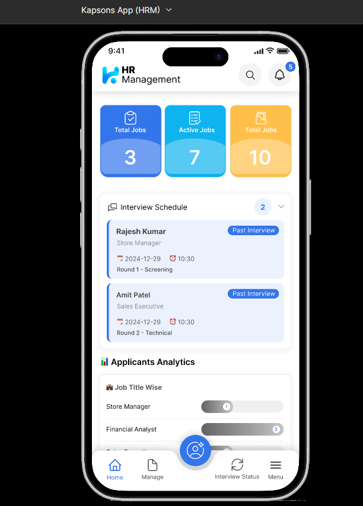
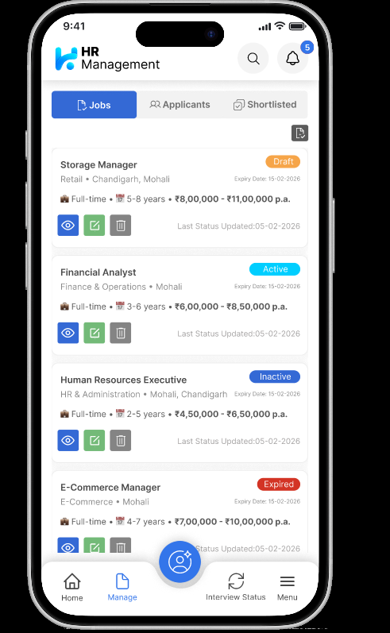
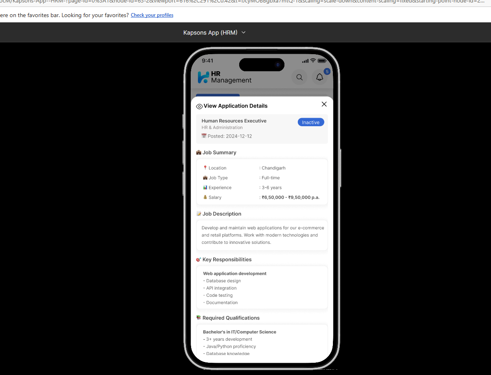
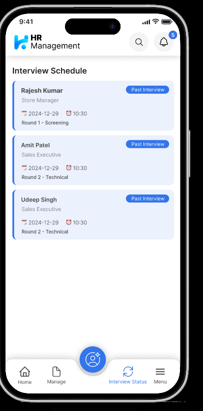
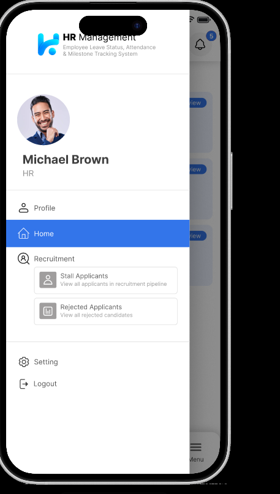
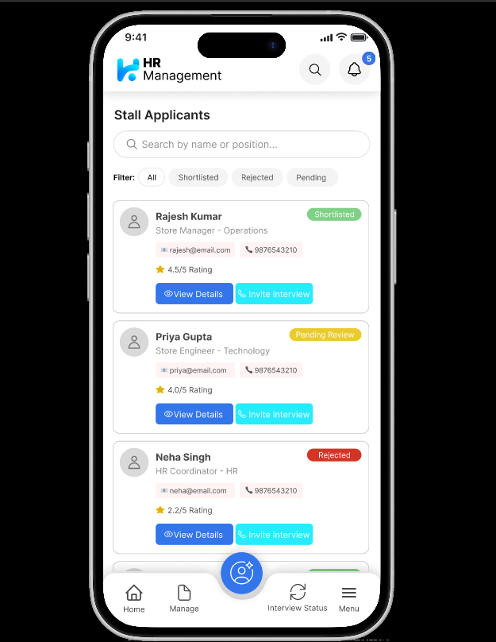
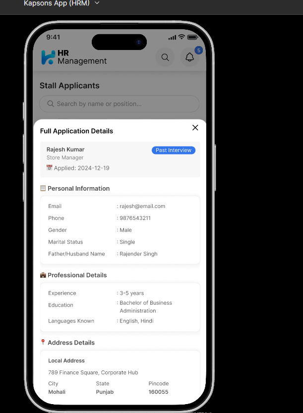
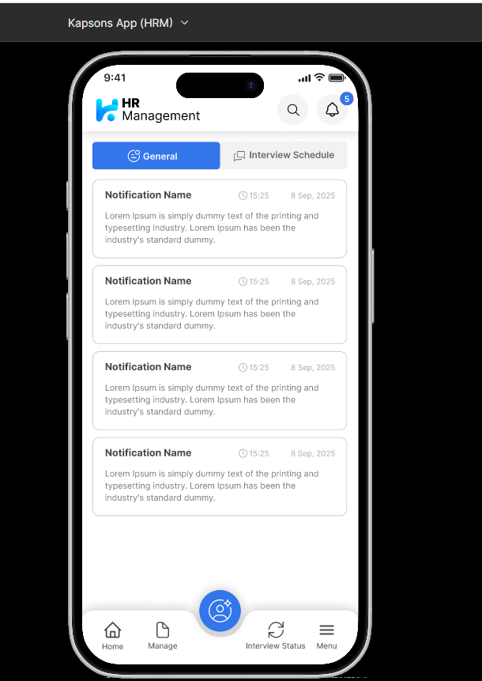
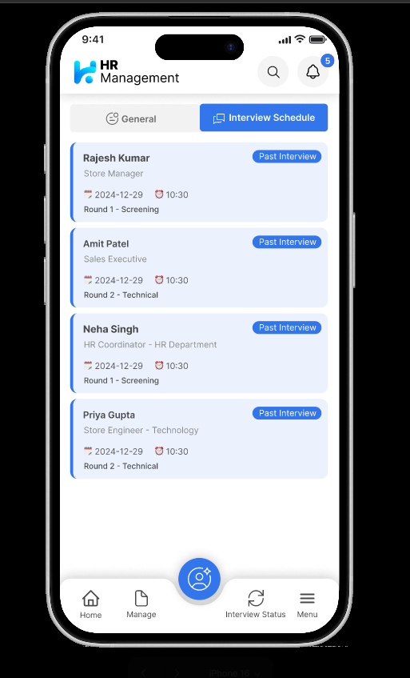

# HR Management Mobile — Reference Screen Catalogue

## Purpose and status

This catalogue preserves the nine mobile screen images supplied during scope planning. The PNG files are stored with the mobile project so they are not lost when temporary clipboard files are deleted.

These images are **visual references, not complete requirements or acceptance criteria**. The authoritative functional scope remains in [`../screens.md`](../screens.md), [`../widgets.md`](../widgets.md), [`../backend.md`](../backend.md), and [`../admin.md`](../admin.md). Implementation must use live API data, role and tenant permissions, accessible controls, responsive layouts, and the configurable theme; it must not hard-code sample names, counts, colours, dates, or statuses shown in the images.

## Reference index

| Reference | Saved asset | Original size | Primary workflow | Planned scope mapping |
|---|---|---:|---|---|
| REF-MOB-001 | [`01-hr-dashboard.png`](screen-references/01-hr-dashboard.png) | 612 × 854 | HR dashboard with KPI tiles, interview preview and applicant analytics | MOB-011, MOB-021, MOB-033; WID-061, WID-072, WID-087 |
| REF-MOB-002 | [`02-manage-jobs.png`](screen-references/02-manage-jobs.png) | 491 × 797 | Job list with segmented views, statuses and quick actions | MOB-026–028, MOB-034–035; WID-028, WID-063, WID-067, WID-079 |
| REF-MOB-003 | [`03-job-details.png`](screen-references/03-job-details.png) | 1205 × 921 | Job details with summary, description, responsibilities and qualifications | MOB-028–031; WID-024, WID-065 |
| REF-MOB-004 | [`04-interview-schedule.png`](screen-references/04-interview-schedule.png) | 406 × 820 | Interview schedule list | MOB-043, MOB-045; WID-068, WID-087 |
| REF-MOB-005 | [`05-navigation-drawer.png`](screen-references/05-navigation-drawer.png) | 457 × 807 | Profile header and role-aware navigation drawer | MOB-107–112; WID-017–021 |
| REF-MOB-006 | [`06-applicant-list.png`](screen-references/06-applicant-list.png) | 625 × 808 | Applicant search, filter chips, cards and recruiter actions | MOB-035–037, MOB-042, MOB-044; WID-045–047, WID-063, WID-067, WID-081 |
| REF-MOB-007 | [`07-applicant-details.png`](screen-references/07-applicant-details.png) | 611 × 834 | Application/candidate details | MOB-036–039; WID-065, WID-077, WID-083 |
| REF-MOB-008 | [`08-notifications-general.png`](screen-references/08-notifications-general.png) | 610 × 861 | General notification list | MOB-016–017; WID-028, WID-063, WID-066 |
| REF-MOB-009 | [`09-notifications-interviews.png`](screen-references/09-notifications-interviews.png) | 513 × 847 | Interview notification/schedule tab | MOB-016, MOB-043–045; WID-028, WID-087 |

## Visual reference sheets

### REF-MOB-001 — HR dashboard

Retain the compact KPI hierarchy, upcoming-interview preview, analytics summary, consistent top bar and thumb-reachable navigation. Dashboard composition and tile visibility must come from the authenticated user's permissions and enabled modules.

### REF-MOB-002 — Manage jobs

Retain the scannable job cards, status visibility, segmented workflow and quick actions. Destructive actions require permission checks and confirmation; list data, available actions and status transitions come from the API.

### REF-MOB-003 — Job details

Retain the grouped job information and strong section hierarchy. Long details should use a routed page or an accessible adaptive sheet instead of forcing all content into a small fixed modal.

### REF-MOB-004 — Interview schedule

Retain the date/time, round, candidate and status information at card level. The implemented view should support date grouping, filters, timezone-safe values and actions determined by interview permissions.

### REF-MOB-005 — Navigation drawer

Retain the profile context, clear selected state and grouped navigation. Menu items must be produced from role permissions and tenant-enabled modules rather than being embedded in XAML.

### REF-MOB-006 — Applicant list

Retain search, compact filters, visible stage/rating and contextual actions. The source label “Stall Applicants” is not product terminology; use **Stalled Applicants** only if that is an approved workflow state, otherwise use **Applicants** with an ageing/stalled filter.

### REF-MOB-007 — Applicant details

Retain the grouped personal and professional information. Personally identifiable information must be field-permission controlled, masked when appropriate, excluded from ordinary disk caches and audited when accessed.

### REF-MOB-008 — General notifications

Retain the simple tabbed list and readable cards. Add read/unread state, pagination, empty/loading/error states, accessible timestamps and deep links supplied by the notification contract.

### REF-MOB-009 — Interview notifications

Retain the interview-specific tab and schedule-card treatment. Reuse the same interview card and route contracts as the dashboard and recruitment schedule rather than creating a separate notification-only implementation.

## Cross-screen visual rules

Use these references to guide:

- compact but readable information hierarchy;
- consistent cards, tabs, badges, search, filters and navigation;
- important status and next action visible without opening every record;
- reusable widgets backed by compiled MVVM bindings;
- tenant-configured logo, colours and labels.

Do not copy literally:

- browser bars, device frames or presentation backgrounds;
- sample people, jobs, counts, dates, salaries or notification text;
- hard-coded blue colours, emoji-based production icons or fixed pixel layouts;
- tiny low-contrast labels, overcrowded floating actions or desktop-style modal assumptions;
- controls that only hide unauthorized actions without matching API authorization.

## Asset integrity

The preserved files are byte-for-byte copies of the supplied PNGs. Short SHA-256 fingerprints are recorded below to detect accidental replacement.

| Asset | SHA-256 prefix |
|---|---|
| `01-hr-dashboard.png` | `423AC3DF5765` |
| `02-manage-jobs.png` | `01FF75F76C78` |
| `03-job-details.png` | `8D516A30540E` |
| `04-interview-schedule.png` | `722F0323949D` |
| `05-navigation-drawer.png` | `5A7F9D650EE9` |
| `06-applicant-list.png` | `2DFFCA9C3DF8` |
| `07-applicant-details.png` | `FF6B7F599632` |
| `08-notifications-general.png` | `36346A8C6070` |
| `09-notifications-interviews.png` | `DEE1A1854A5A` |
